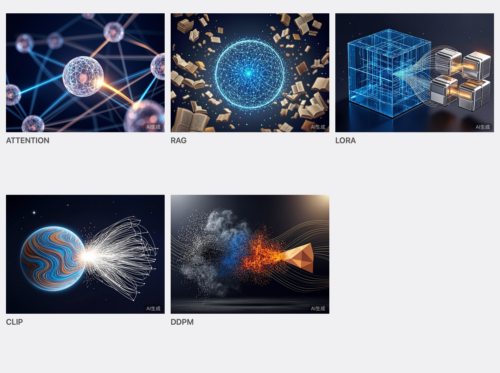

# GLM-Image 五次真实测试

2026-11-16。用户明确授权 5 次调用；使用原有智谱 Key，通过项目原生 `ImageGenerationService` 执行。

- 模型：`glm-image`；请求尺寸：`1536x1152`；质量：`hd`。
- 5 次串行 POST，全部成功，图片均下载、解码为本地 JPEG；没有额外生图重试。
- 每张均为 1536×1152，精确 4:3；没有标题文字，保留服务商“AI生成”水印。
- 按官方 0.1 元/次参考价估算合计约 0.5 元，实际以平台账单为准。
- Key 仅通过隐藏输入进入诊断进程内存；没有修改设备钥匙串、本地演示额度或用户封面。
- 本目录不保存密钥或临时下载 URL；results.json 保存提示词、耗时、尺寸等可复查信息。

| 主题 | 生图耗时 | 下载后总耗时 | 图片 |
| --- | ---: | ---: | --- |
| ATTENTION | 53.9 秒 | 54.4 秒 | [attention.jpg](attention.jpg) |
| RAG | 126.0 秒 | 126.5 秒 | [rag.jpg](rag.jpg) |
| LORA | 54.4 秒 | 54.8 秒 | [lora.jpg](lora.jpg) |
| CLIP | 94.3 秒 | 94.8 秒 | [clip.jpg](clip.jpg) |
| DDPM | 53.3 秒 | 53.6 秒 | [ddpm.jpg](ddpm.jpg) |

平均生图 76.4 秒，中位数 54.4 秒，范围 53.3–126.0 秒。

图片是主题概念示意，不是论文原始图表；CLIP 等抽象主题的画面不等于准确的方法图。本次只验证接口与下载链路，不替代手机端操作验收，也不改变论文原图优先的规则。

官方参数与参考价格：[GLM-Image](https://docs.bigmodel.cn/cn/guide/models/image-generation/glm-image)。
