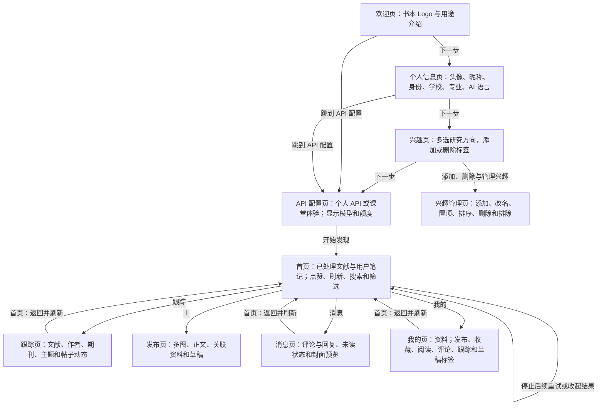
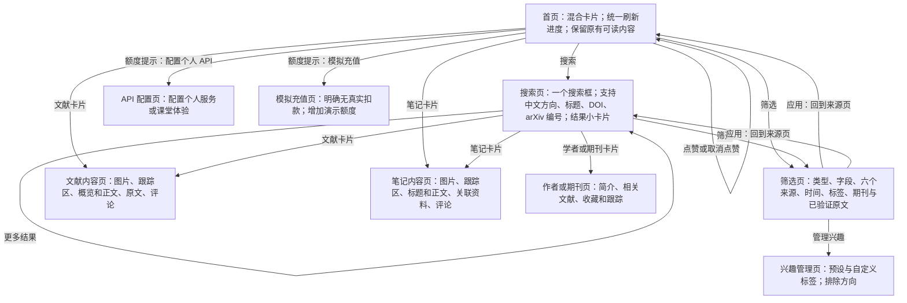
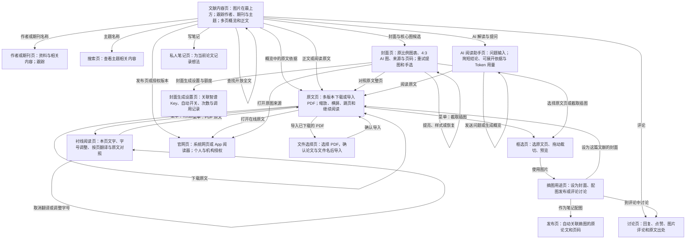
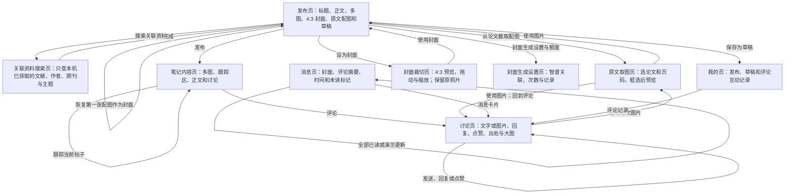
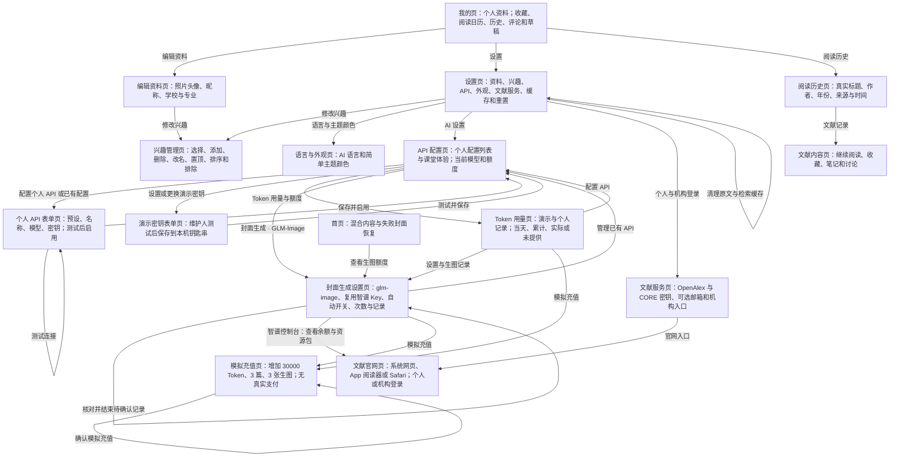
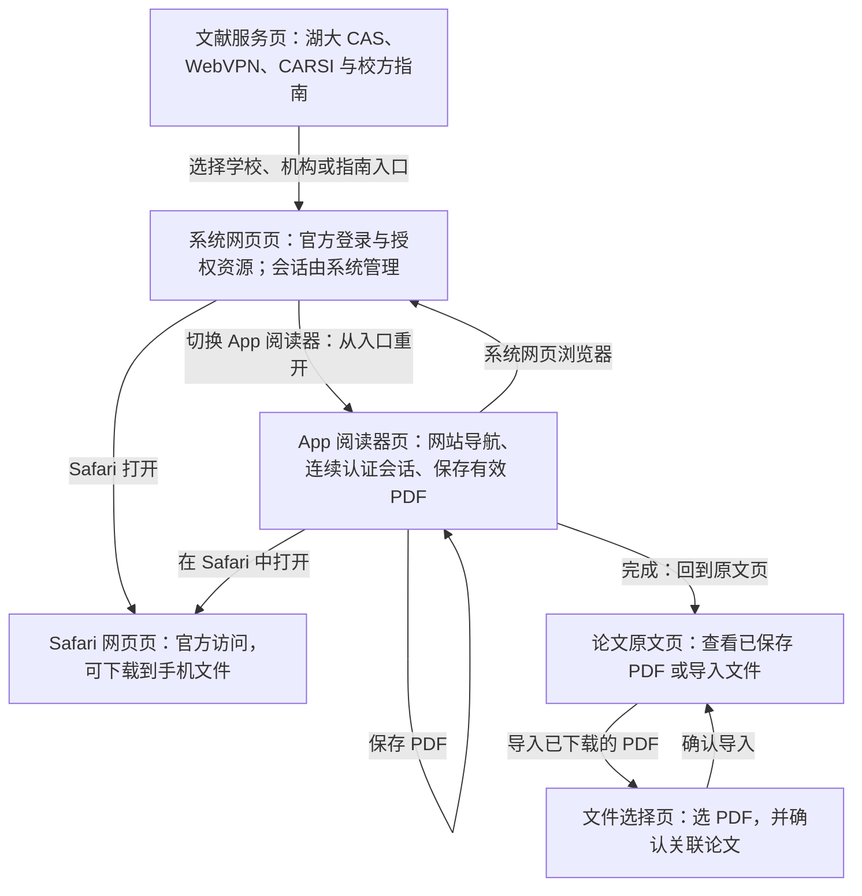

# PaperFlow：页面架构与按钮跳转

第十二稿，2026-11-16，对应 iOS 1.8.2。安卓本轮不变。

每个节点是一页，弹出表单也算一页。每条线代表一个按钮或可点击卡片；指向自己表示在原页操作。左右滑动、启动、计时和网络处理不是按钮，不画成线。二级页的系统“返回”统一回到来路，图中省略。

打开时显示书本 Logo。首页的文献和用户笔记混合展示；文献正文先完成 AI 处理，封面独立加载。检索结果可以只有原始资料，用户仍能直接读原文。

## 首次进入与主导航

四个主页面共用底部“首页、跟踪、＋、消息、我的”。从任一主页面都可使用这些按钮；图中只展开首页的连接。

## 发现与统一搜索

下拉刷新和底部“首页”使用相同准备流程。网络召回后，按兴趣与有效阅读偏好排序，先验证原文，再生成解读；封面独立后台准备，跳过取文或生成失败的论文；已有内容继续显示。加载更多按来源游标翻页，追加到当前列表。首页负反馈不影响主动搜索。统一检索 arXiv、HAL、Europe PMC、CORE、OpenAlex、Crossref。学者与期刊类型也查询网络；筛选“可直接阅读全文”时验证本批前 10 个候选，允许继续加载。

## 文献、原文与 AI

封面顺序：本人设置 → 网页原图或合格 PDF 图表 → GLM-Image 示意图。原图按自身比例完整显示，不裁切、不额外补边；AI 图保持 4:3，标题与 AI 标记在图片外。最多三张原图候选，可切换并查看来源。重新提图免费，生图另行计次。原图失败缓存 24 小时，已生成图片长期复用；下载失败只重试下载，生图结果不明不自动重发。余额恢复后可手动批量重试明确余额失败的封面。图片准备不阻塞正文。

## 发布、评论与消息

社区仍是本机演示。跟踪后可通过“消息 → 演示更新”生成新评论或回复，演示通知流程；没有跨设备同步或系统推送。

## 个人页、设置与额度

## 机构访问与导入

进入机构网页不等于已登录。系统网页、Safari 与 App 阅读器会话不自动互通，切换可能需要重新登录；App 阅读器内部的学校、CARSI 与出版社可连续跳转。网站有权决定下载和订购范围。系统网页下载后，可回论文原文页导入；打开官网不能自动给文献 API 授权。

课堂演示直接由手机调用智谱 `glm-5.2`。维护人首次在手机设置密钥，后续演示不依赖 Mac。3 篇与 30000 Token 先到为准，原文、缓存和已完成内容不受限；额度本地控制，只用于课堂。实际 Token 取接口返回值；无用量回执时保留待确认预算。

设计继续采用小红书的小卡片、图片与轻互动，结合 ResearchGate 的文献身份、作者、期刊和原文关联。兴趣、阅读与收藏帮助调整推荐；配置、用量和授权访问都有统一入口，减少页面层级。
